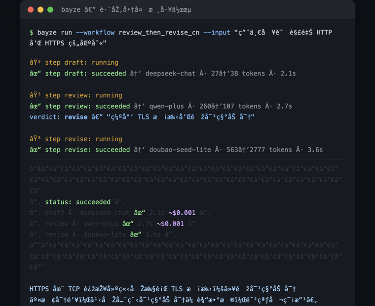

# Bayze

[](https://github.com/caijianxiong2007-prog/bayze-mcp/actions/workflows/ci.yml)



A local-first, auditable, open-source **AI model-routing core**. Bayze plugs into MCP-capable AI clients over stdio and runs explicit multi-model workflows — starting with `review_then_revise`: one model drafts, a second model structurally reviews, a third revises only when rejected.

Bring your own keys (BYOK). No telemetry, no cloud components, no listening ports.

## Highlights

- **Waterfall with mandatory structured review** — the reviewer must return `{"verdict":"accept"|"revise","reasons":[...]}`; unparseable reviews fail closed (never silently accepted)
- **Explainable escalation** — every step records provider, model, trigger reason, usage and estimated cost; deterministic checks use structured `check_failed:<id>` reasons
- **Budget guard** — conservative pre-call reservation, actual-usage settlement, hard USD cap; unknown prices fail closed unless explicitly allowed
- **Privacy by construction** — keys are read from environment variables only; the local journal stores run summaries (status/models/usage/cost) — never prompts or responses; 7-day/10MB rotation, one-command clear
- **Provider adapters** — OpenAI-compatible (DeepSeek, DashScope, Volcengine Ark, OpenAI, …) plus a native Anthropic Messages adapter (different protocol/auth/error taxonomy); a mock adapter exercises every failure path without keys
- **MCP-native** — three tools (`list_workflows`, `run_workflow`, `get_run_summary`), step-level progress notifications, cancellation propagation, per-client stdio process (no daemon)

## Requirements

- Node.js ≥ 22 LTS

## Install

```bash
# Run directly (recommended)
npx -y bayze-mcp mcp --config /path/to/config.yaml

# Or install globally
npm install -g bayze-mcp
bayze config check --config /path/to/config.yaml
```

Configuration is a versioned YAML file: providers (`env:` key references only), models with optional pricing, and waterfall workflows with limits and per-step run conditions. Ready-made templates:

- Mainland China: `examples/config.cn.example.yaml` — DeepSeek → Qwen → Doubao cross-vendor review (CNY pricing / USD budget boundary explained)
- International: `examples/config.intl.example.yaml` — OpenAI and OpenAI→Claude cross-vendor review

All endpoint/model IDs are public shapes marked for verification; **all prices are placeholder data** — check official pricing pages.

### Multi-AI collaboration upgrades (v0.11.0, [ADR-0006](docs/adr/0006-multi-ai-collaboration.md))

- **parallel + judge**: add `judge: { provider, model }` and an arbiter model picks the best candidate —
  `finalOutput` becomes the winner (with `judgeSummary` reason); judge failure falls back to concatenated
  comparison. Every parallel run also reports `agreement` (0-1, deterministic cross-model agreement signal,
  zero extra calls — it is not any model's self-confidence).
- **MoA aggregation** (`strategy: moa` + required `aggregate: { provider, model }`): N models answer in
  parallel, then a synthesizer model combines them into one final answer (claims consistent across candidates
  win, single-candidate errors drop) — research-backed to often beat the best single model. Fails open to
  concatenated comparison.
- **Debate** (`strategy: debate` + required `judge` arbiter + optional `rounds`, default 1): two models open
  independently, rebut each other for K rounds (stance emerges from disagreement), then an arbiter weighs the
  arguments and delivers the final answer (with deterministic checks on the verdict). Falls back to the debate
  transcript if the arbiter fails.
- **waterfall revision loop**: `limits.max_revisions: 2` re-runs review→revise until accept (default 1 = old
  behavior). Review prompts now carry a scoring rubric (customize with `rubric:` on the gate step) — score each
  item before the verdict. Optional `escalate_to: { provider, model }` hands the final revision to a stronger
  model when the loop is exhausted.

### Bayze unified API mode (no per-vendor accounts)

If you don't want to register at every vendor or deal with foreign payment methods, declare a provider with `mode: bayze_api`. One account, one balance, one API key (`lw-…`) covering 21+ text models plus image/video, OpenAI-compatible (`base_url` pinned to `https://app.lanwealth.com/v1`). Three steps:

1. **Sign up** (1,200 free points on signup, no credit card): <https://app.lanwealth.com/auth/login>
2. **Create an API key** in the console, then `export BAYZE_API_KEY=lw-xxxx`
3. **Start from** `examples/config.bayze.example.yaml` — `bayze config check` detects the mode and prints the same walkthrough

Honest notes: requests are relayed through the Bayze server to the actual vendors (no "local-only processing" claim for this mode); top up with Alipay / WeChat Pay / international cards at <https://app.lanwealth.com/dashboard/billing>, pay-as-you-go per the platform bill; model IDs follow the platform catalog. On **insufficient balance the platform returns 402** — Bayze maps it to `insufficient_balance` with the top-up link in the error; `bayze balance [--config …]` queries your points balance from the CLI. A 401 error message includes the signup link. BYOK and this mode can coexist in one config — pick per workflow.

## Client setup

Works with any MCP client that supports stdio servers (Claude Desktop, Cursor, Cherry Studio, …). See `docs/mcp-clients.md`. Three tools are exposed; `finalOutput` is always flagged `finalOutputUntrusted: true` — model-generated content, not instructions.

## Recommended usage

Once connected, **just talk to your AI assistant naturally** — it sees workflow profiles (quality tier, description) and recommends the right path.

### By scenario

| Scenario | Say this | Workflow | Cost/run | Time |
|---|---|---|---|---|
| Quick Q&A / translation | Just ask, or "use quick_answer for: …" | `quick_answer` | ~$0.001 | ~2s |
| Cross-vendor review needed | "use review_then_revise_cn for: …" | DeepSeek→Qwen→Doubao | ~$0.003 | ~8s |
| Strongest review (cross-border) | "use review_then_revise_cross_intl for: …" | DeepSeek→Claude→Doubao | ~$0.005 | ~10s |
| Via Bayze unified API | "use review_then_revise_bayze for: …" | Bayze API channel | per platform bill | ~10s |
| Hard character-limit writing | "use constrained_writing: … (strictly under N chars)" | deterministic max_chars | ~$0.001 | ~2s |

### Tips (from real-world usage)

- **Use strict wording for hard constraints**: "strictly under N characters" triggers deterministic engine checks; "about N characters" lets the model be lenient
- **Don't use review workflows for simple tasks**: 3-10x cost and 2-5x latency for marginal quality gain
- **Trust the engine's character count, not the reviewer's**: reviewer models systematically miscount by 11-38 characters
- **BYOK is faster than Bayze API**: 3-5x speed difference (extra gateway hop)
- **When status ≠ succeeded, check warnings**: they contain specific failure reasons and completed step info

## Documentation

- `docs/baseline-spec.md` — the single source of truth (implementation constraints & acceptance checklist)
- `docs/architecture.md` · `docs/privacy.md` · `docs/threat-model.md`
- `docs/dependencies.md` · `docs/acceptance-status.md` · `CHANGELOG.md`

## Status

P0 complete: 103 tests green, `npm audit` clean, verified online against five providers (DeepSeek / Qwen / Doubao / OpenAI / Anthropic) including a real cross-vendor review loop in a production MCP client. Regional strategy: one codebase, distribution-level config differences only.

## License

[MIT](LICENSE)
