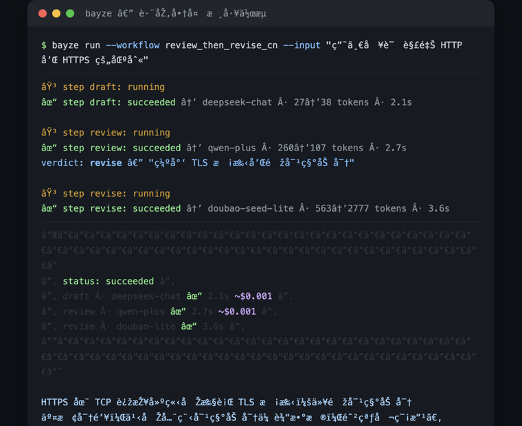

# Bayze

[](https://github.com/caijianxiong2007-prog/bayze-mcp/actions/workflows/ci.yml) · [English](README.en.md)



本地运行、可审计、可扩展的开源 AI 模型路由核心。通过 MCP stdio 接入支持工具调用的 AI 客户端：`review_then_revise` 瀑布工作流（草稿 → 必经结构化评审 → 按需修订）、`parallel` 多模型并行比较（可选评委自动选优）、`moa` 多模型聚合、localhost OpenAI 兼容 API（含 SSE 流式与 Web UI 仪表板）、可选的人工批准门槛（`approval_threshold_usd`）。

> 状态：**P0 全部阶段（0–5）+ P1 + P2 主体完成** —— 144 项测试全绿；`npm audit` 0 漏洞；`npm ci` 干净安装复现通过；真实供应商在线联调已于 2026-11-03 通过（大陆向跨厂商）。待人工项见[验收状态矩阵](docs/acceptance-status.md)（真实客户端注册核验、Linux/Windows 平台实测）。许可证 MIT。用户自带模型凭证（BYOK）；默认无遥测、无云端组件、无本地监听。

## 环境要求

- Node.js ≥ 22 LTS

## 安装

已发布 npm（包名 `bayze-mcp`，命令 `bayze`），三种方式任选：

```bash
# 方式 1：npx 直接跑（推荐，无需安装）
npx -y bayze-mcp mcp --config /path/to/your/config.yaml

# 方式 2：全局安装
npm install -g bayze-mcp
bayze config check --config /path/to/your/config.yaml

# 方式 3：从源码（本仓库）
git clone <repo-url> && cd bayze-mcp && npm ci && npm run build
```

> 密钥只放环境变量（`env:` 引用）；示例配置见 [examples/](examples/)（大陆向 DeepSeek/DashScope/火山方舟 + 国际向 OpenAI/Anthropic，价格均为待核验假数据）。

## 快速开始（阶段 1：配置校验，只读）

```bash
npm install
npm run build

# 校验自带 mock 示例（无需任何密钥）
node dist/src/cli.js config check --config examples/config.example.yaml

# 严格模式：同时验证所有 env: 引用可解析（只报变量名，不报值）
BAYZE_EXAMPLE_API_KEY=dummy node dist/src/cli.js config check --config examples/config.example.yaml --strict

# 运行首发工作流（草稿 → 必经结构化评审 → 按需修订）；返回结构化 JSON
node dist/src/cli.js run --workflow review_then_revise_mock --config examples/config.example.yaml --input "用一句话解释 MCP 协议"

# 启动 MCP stdio server（接入 AI 客户端；每客户端一个子进程，无监听端口）
node dist/src/cli.js mcp --config examples/config.example.yaml

# 运行摘要 journal：查看 / 清除（默认仅摘要，7 天 / 10MB，不含输入与输出内容）
node dist/src/cli.js journal tail 5
node dist/src/cli.js journal clear

# Bayze API 模式：查点数余额（密钥取自配置中 bayze_api 供应商的引用）
node dist/src/cli.js balance --config examples/config.bayze.example.yaml

# 查看默认配置路径（OS 用户配置目录；Bayze 只读取，不写入）
node dist/src/cli.js config path
```

**接入 AI 客户端**（Claude Desktop / Cursor / Cherry Studio 等支持 MCP 的客户端）：见 [docs/mcp-clients.md](docs/mcp-clients.md)。三工具：`list_workflows`、`run_workflow`（长任务带步骤级进度通知，可取消）、`get_run_summary`。

## 推荐用法

接入客户端后，**直接用自然语言对话即可**——AI 助理会看到工作流的 profile 元数据（质量档位/描述），自动推荐合适的路径。

### 按场景选择

| 场景 | 建议说 | 工作流 | 成本/次 | 耗时 |
|---|---|---|---|---|
| 日常问答/翻译/格式转换 | 直接问，或「用 quick_answer 处理：…」 | `quick_answer` | ~$0.001 | ~2s |
| 重要内容需跨厂商复核 | 「用 review_then_revise_cn 处理：…」 | DeepSeek→通义→豆包 | ~$0.003 | ~8s |
| 跨境最强评审 | 「用 review_then_revise_cross_intl 处理：…」 | DeepSeek→Claude→豆包 | ~$0.005 | ~10s |
| 走 Bayze 统一 API 额度 | 「用 review_then_revise_bayze 处理：…」 | Bayze API 通道 | 按平台账单 | ~10s |
| 有字数硬约束的写作 | 「用 constrained_writing 写：…（严格 N 字以内）」 | 确定性 max_chars | ~$0.001 | ~2s |

### 实用技巧（来自真实使用经验）

- **硬约束用硬措辞**：「严格 N 字以内」比「N 字左右」有效——前者引擎会确定性检查，后者模型会宽容理解
- **简单任务别用复核工作流**：多花 3~10 倍费用和 2~5 倍时间，质量提升有限
- **字数合规看引擎，别信评审自报**：评审模型的字数计数系统性地不准（实测偏差 11~38 字）
- **追求速度用 BYOK 直连**：Bayez API 通道比直连慢 3~5 倍（多一跳网关）
- **`status` 不是 `succeeded` 时看 `warnings`**：那里有具体的失败原因和已完成的步骤信息

**接入真实供应商**（BYOK，密钥只放环境变量）：在配置中声明 `kind: openai-compatible`（如 DeepSeek/通义/火山方舟等 OpenAI 兼容端点）、`kind: anthropic` 或 `kind: gemini`，设置 `api_key_ref: env:你的变量名`，并从官方价格页核实模型定价（示例中的价格均为假数据）。参考发行示例：

- **大陆向**：[examples/config.cn.example.yaml](examples/config.cn.example.yaml) —— DeepSeek 起草 → 通义 DashScope 评审 → 火山方舟（豆包）修订的跨厂商工作流；含 CNY 定价与 USD 预算（`allow_unknown_price`）的边界说明
- **国际向**：[examples/config.intl.example.yaml](examples/config.intl.example.yaml) —— OpenAI（同厂分级复核：gpt-4o-mini → gpt-4o）+ Anthropic（跨厂商复核：OpenAI 起草 → Claude 评审）+ Google Gemini（`kind: gemini` 独立适配器）；USD 定价下硬预算直接生效
- 通用形态（含 Anthropic 与本地端点 opt-in）：[examples/config.example.yaml](examples/config.example.yaml)

```bash
export BAYZE_DEEPSEEK_API_KEY=... 等      # 密钥只进环境变量
node dist/src/cli.js config check --config <你的配置> --strict
node dist/src/cli.js run --workflow <你的工作流> --config <你的配置> --input "任务"
```

**多 AI 协作增强**（v0.11.0 / [ADR-0006](docs/adr/0006-multi-ai-collaboration.md)）：

- `parallel` + 评委自动选优：配置 `judge: { provider, model }` 后，引擎让评委模型从多份候选中选出最优，
  `finalOutput` 直接是胜者内容（附 `judgeSummary` 理由）；评委失败自动降级为拼接对比。同时返回
  `agreement`（0-1，多模型答案的相互印证程度，零额外调用——不是任何模型的自信度）
- `waterfall` 修订循环：`limits.max_revisions: 2` 让「评审→修订」循环到 accept 为止（默认 1 次不变）；
  评审提示内置四项评分 rubric（gate 步骤可用 `rubric:` 自定义），先打分再下结论，治评审判准漂移；
  可选 `escalate_to: { provider, model }` 在循环用尽后换强模型做最后一次修订

```yaml
# parallel + 评委选优示例
compare_judged:
  strategy: parallel
  judge: { provider: anthropic, model: claude-sonnet-4-5 }   # 可选：自动选优
  limits: { max_steps: 3, total_timeout_ms: 120000, max_output_tokens: 8000 }
  steps:
    - { name: deepseek, provider: deepseek, model: deepseek-chat, input: original, timeout_ms: 60000, evaluate: [non_empty] }
    - { name: qwen, provider: dashscope, model: qwen-plus, input: original, timeout_ms: 60000, evaluate: [non_empty] }

# MoA 聚合示例：多模型各写一版 → 强模型合成最优答案
synthesize:
  strategy: moa
  aggregate:
    provider: anthropic
    model: claude-sonnet-4-5        # 必配：合成模型
    evaluate: [non_empty, { max_chars: 400 }]   # 可选：成品确定性检查（聚合倾向写长，建议设上限）
  limits: { max_steps: 3, total_timeout_ms: 180000, max_output_tokens: 8000 }
  steps:
    - { name: deepseek, provider: deepseek, model: deepseek-chat, input: original, timeout_ms: 60000, evaluate: [non_empty] }
    - { name: qwen, provider: dashscope, model: qwen-plus, input: original, timeout_ms: 60000, evaluate: [non_empty] }

# waterfall 修订循环 + 升级示例
review_loop:
  strategy: waterfall
  escalate_to: { provider: anthropic, model: claude-sonnet-4-5 }   # 可选：循环用尽后换强模型
  limits: { max_steps: 8, total_timeout_ms: 180000, max_output_tokens: 8000, max_revisions: 2 }
  steps: [ ...draft → review → revise 与常规相同... ]
```

**Bayze 统一 API 模式**（没有各家账号也能跑）：不想逐家注册/海外支付时，可将 provider 声明为 `mode: bayze_api`（`base_url` 固定 `https://app.lanwealth.com/v1`，OpenAI 兼容）。三步接入：

1. 注册/登录（送 1,200 免费积分，无需信用卡）：<https://app.lanwealth.com/auth/login>
2. 控制台创建 API Key（`lw-` 开头）→ `export BAYZE_API_KEY=lw-xxxx`
3. 以 [examples/config.bayze.example.yaml](examples/config.bayze.example.yaml) 为起点；`config check` 检测到该模式会打印同样的引导

说明（如实）：此模式下请求经 Bayze 服务端转发至实际供应商（不宣称「只在本机处理」）；充值（支付宝/微信/国际卡）与账单：<https://app.lanwealth.com/dashboard/billing>，按量计费以平台账单为准；模型 id 以平台开放目录为准；**余额不足时平台返回 402**，Bayze 将其映射为 `insufficient_balance` 并在错误信息附充值直链。BYOK 与此模式可在同一配置中并存、按工作流选用。

示例配置使用 mock provider 演练全部路径（成功 / 空输出 / 超时 / 限流 / 挂起中止等）；`example-remote` 为假数据的 OpenAI 兼容供应商样例——密钥仅允许 `env:` 引用。真实供应商适配器在阶段 4 交付。

配置错误会定位到具体字段，例如：

```text
config check failed (invalid): /path/to/config.yaml
  providers.bad-remote.base_url: scheme "http" is not https; set allow_insecure_base_url: true ...
  workflows.w.steps.0.provider: unknown provider "ghost" (configured: bad-remote)
```

## 测试

```bash
npm test   # 101 项：配置 schema、凭证、mock 确定性、脱敏、模板、评审解析、预算、状态机全分支、调度、journal、MCP 三工具（含真实 stdio 端到端）、OpenAI/Anthropic 适配器契约（本地回环 HTTP）
```

## 文档

- [实施基线规范 v0.3](docs/baseline-spec.md) —— 全部实施约束与验收清单的单一事实来源
- [架构与数据流](docs/architecture.md) · [隐私说明](docs/privacy.md) · [威胁模型](docs/threat-model.md)
- [依赖许可清单](docs/dependencies.md) · [验收状态矩阵](docs/acceptance-status.md) · [Changelog](CHANGELOG.md)
- [ADR-0001 运行时与工具链](docs/adr/0001-runtime-and-tooling.md)
- [MCP 客户端接入](docs/mcp-clients.md)
- 许可证 [MIT](LICENSE) · [贡献指南](CONTRIBUTING.md) · [AGENTS.md](AGENTS.md) —— 仓库工作规则

## 技术栈（ADR-0001）

TypeScript（strict）+ Node.js ≥ 22 LTS · 官方 `@modelcontextprotocol/sdk`（阶段 3 引入，stdio）· YAML + Zod 配置 · 凭证仅环境变量引用 · npm/npx 分发

## 交付阶段

见基线规范 §11：**0 方案核验 ✓** → **1 核心骨架 ✓** → **2 瀑布引擎 ✓** → **3 MCP 接入 ✓** → **4 真实供应商 ✓（契约级）** → **5 安全与发布 ✓**
